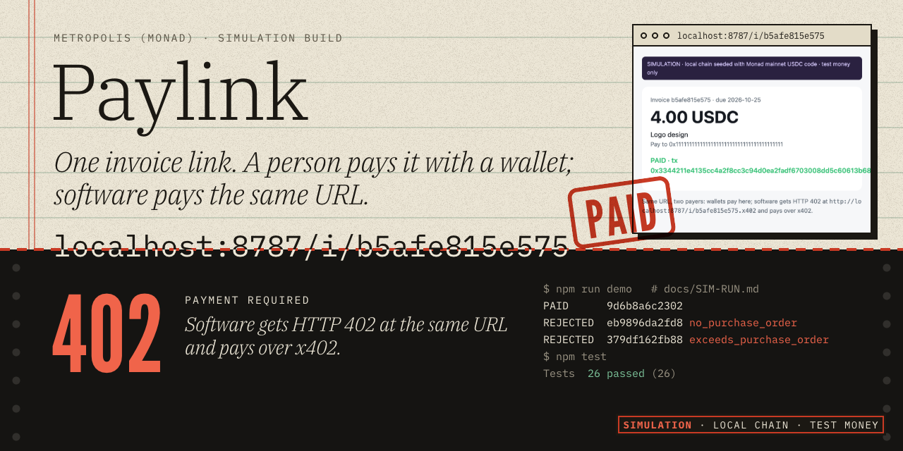
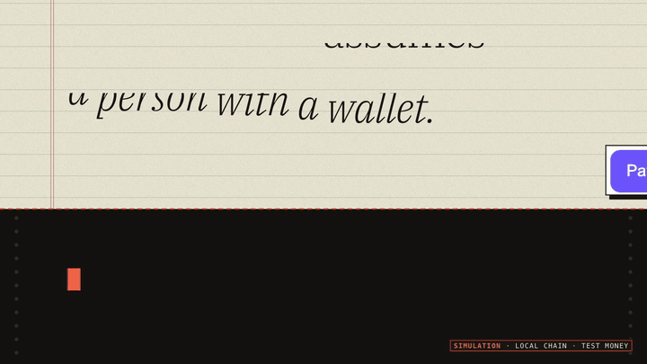

# Paylink — one invoice link, two kinds of payer



> **Note (2026-10-11):** the team's Metropolis submission is [Spreadbounty](https://github.com/Ps23102004/spreadbounty); Paylink is the backup build. A 10-judge panel (Opus 5.5 + Fable 5.1, five roles) scored it 5.0/10 — mainly for sitting in a crowded x402-invoice lane and never having run live. Everything below is still true and runs.

[20-second launch video](docs/media/paylink-launch-20s.mp4) · [88-second walkthrough](docs/media/paylink-walkthrough.mp4) · launch post copy in [docs/LAUNCH.md](docs/LAUNCH.md)



A freelancer sends one URL. A person opens it and pays with a wallet. An accounts-payable **agent** hits the same URL, gets **HTTP 402**, and pays over **x402**. Both settle as USDC on Monad through the same EIP-3009 authorization, and the invoice is marked paid **only after the payment is re-derived from chain logs**.

> **Status, plainly:** built for Metropolis (Monad), Track 2. Everything below was run on a **local simulation chain** (Monad mainnet's real USDC bytecode and state, test money). Not yet run live on Monad. See [docs/SIMULATION.md](docs/SIMULATION.md) for exactly what is real and what is simulated.

## Run it

```bash
npm install
npm test            # 26 tests, ~3 s, offline
npm run demo        # scripted end-to-end run -> docs/SIM-RUN.md
npm run serve       # http://localhost:8787  (simulation; starts its own local chain)
npm run probe       # READ-ONLY checks against the real Monad facilitator + mainnet/testnet USDC
```

## How it works

1. `POST /api/invoices` → id + URL. The invoice defines an EIP-3009 **nonce = keccak256(invoiceId)**.
2. Browser (`Accept: text/html`) gets a pay page. Software gets `402` with x402 v2 requirements (`PAYMENT-REQUIRED` header + body) at the same URL (`/i/:id`, or `/i/:id.x402` to force it).
3. The payer signs `TransferWithAuthorization` (no gas, no transaction by them) and retries with `PAYMENT-SIGNATURE`.
4. The server pins the amount, recipient, network, asset and nonce to the invoice, asks the facilitator to verify and settle (the facilitator pays gas), then **re-reads the settlement tx logs**: exactly one `AuthorizationUsed(nonce)` and a matching `Transfer`. Only then is it PAID.
5. A second payer is blocked even if the first paid outside this server: the server scans for the invoice nonce on-chain first.

The AP agent (`src/agent.ts`) refuses anything without a purchase order that covers it, and anything on an unexpected network or asset.

## What was verified

| Claim | Evidence |
|---|---|
| Logic runs on Monad's real USDC bytecode | `test/paylink.test.ts` seeds a local chain from `fixtures/usdc-monad.json` (snapshot at mainnet block 112557617, incl. its linked signature library) |
| EIP-712 domain matches live Monad mainnet **and** testnet USDC | [docs/READONLY-PROBE.md](docs/READONLY-PROBE.md) (on-chain `DOMAIN_SEPARATOR` = ours) |
| Real Monad facilitator accepts our payload shape | same file; it returned `insufficient_funds` for an unfunded throwaway key, not a format error |
| Human flow works in a real browser | pay page driven in a browser against the sim server; same signing path as the agent |
| Tampering fails | 26 tests: wrong amount/recipient/nonce/network/asset, forged `from`, expiring auth, replay, two payers, concurrent payers, plain transfer ≠ payment, A's payment ≠ B's |

## Known limits (read before relying on it)

- **Not run live on Monad yet.** `scripts/day0-live.ts` does it with a fresh throwaway key (testnet is free).
- Invoices are in memory (restart loses the list; on-chain payments persist). No auth or rate limiting on invoice creation. This is a hackathon build, not a service.
- Stock x402 clients pick a random nonce and will be rejected (`nonce_not_bound_to_invoice`): the invoice-bound nonce is the trustless-receipt feature, and it needs a client that reads `extra.nonce` (ours do).
- Browser-wallet path (`window.ethereum`) is implemented but untested with a real wallet. **No Privy integration.**
- Public RPCs may cap `eth_getLogs` ranges; the cross-payer scan falls back to server state if the query fails.
- Cross-border fee savings and demand are **unvalidated**: no users, no sponsor, no off-ramp integration.
